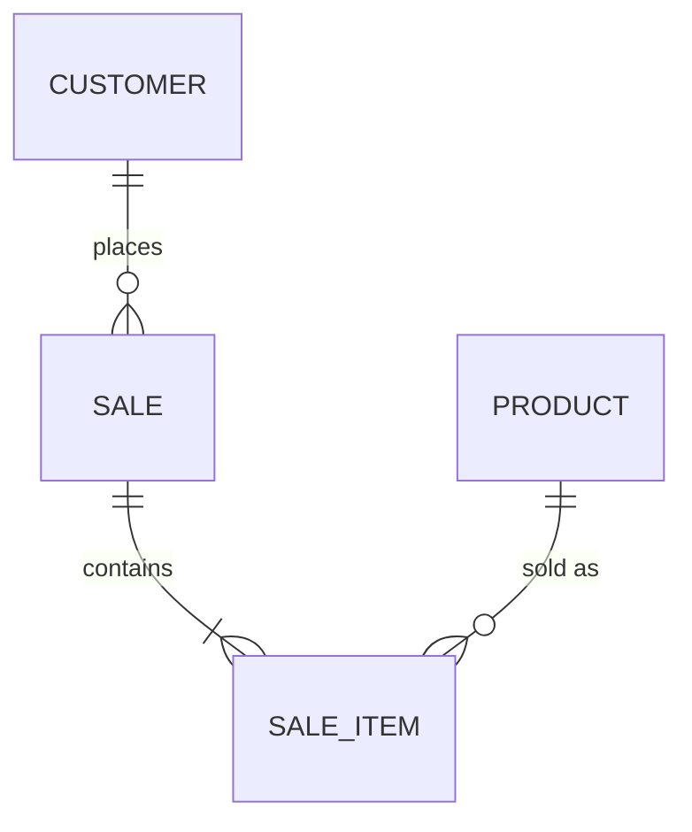

# Diseño de base de datos

## 1. Modelo conceptual
Desde historias y reglas de negocio: entidades, atributos, relaciones, cardinalidad. Diagrama en `docs/data/modelo.md`:

## 2. Modelo físico — convenciones
- Tablas en plural snake_case (`sale_items`), PK `id` (UUID v7/ULID si hay sync offline o exposición pública; `bigint identity` si no).
- Columnas estándar: `created_at timestamptz default now()`, `updated_at timestamptz`, `version int` si hay concurrencia/sync, `deleted_at` sólo con requisito de auditoría.
- Dinero `numeric(14,2)`; cantidades `numeric(12,3)` si hay fraccionados.
- Enums: tabla de referencia o `CHECK` (evitar enum nativo si va a cambiar seguido).
- FKs con `ON DELETE` explícito; índices en todas las FKs y columnas de filtro frecuente.
- `UNIQUE` para reglas de unicidad de negocio (ej. `(tenant_id, cuit)`).
- Multi-tenant: `tenant_id` en todas las tablas de negocio + índice compuesto, o schema por tenant (ADR).
- Auditoría: tabla `audit_log` (quién, qué, cuándo, antes/después) para operaciones sensibles.

## 3. Diccionario (`docs/data/diccionario.md`)
| Tabla | Columna | Tipo | Null | Default | Descripción | Regla | Sensible |

## 4. Migraciones
- TypeORM: `npm run typeorm migration:generate -- src/migrations/<Nombre>` y revisar el SQL a mano.
- Prisma: `npx prisma migrate dev --name <nombre>`; en prod `prisma migrate deploy`.
- Migraciones con datos (backfill) separadas de las de esquema; en tablas grandes, en lotes.
- Cambios sin downtime: agregar columna nullable → backfill → constraint → código nuevo → borrar lo viejo en otro release.

## 5. Seeds
Datos de desarrollo realistas (nombres, CUITs de prueba, montos) sin datos reales de personas.

## 6. Performance
`EXPLAIN (ANALYZE, BUFFERS)` de las consultas críticas; índices parciales/compuestos según filtros reales; evitar N+1 (relaciones con join explícito o DataLoader).
