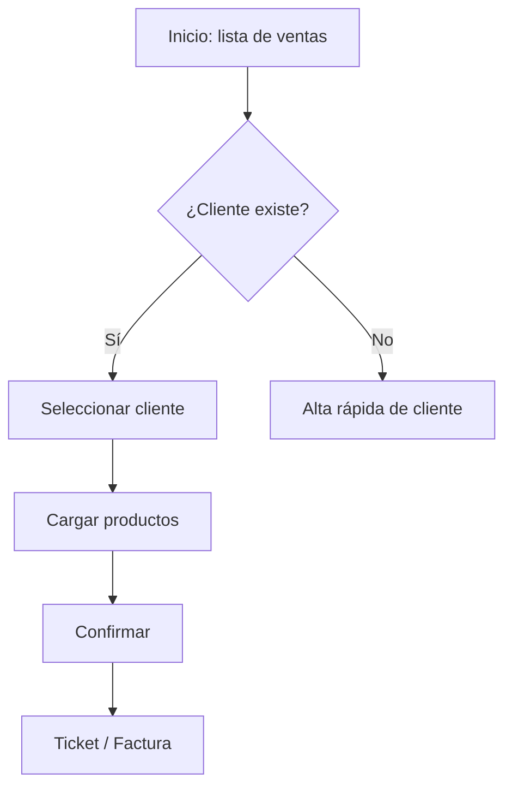

# Flujos y pantallas

## 1. Flujos (`docs/ux/flujos.md`)
Un diagrama por tarea principal:



## 2. Pantalla (`docs/ux/pantallas/<nombre>.md`)

```markdown
# Pantalla: <nombre>  (US-NNN)
Objetivo del usuario:
Ruta: /ventas/nueva   · Roles: vendedor, admin

## Wireframe
+--------------------------------------------------+
| ← Volver        Nueva venta            [Guardar] |
| Cliente: [ buscar…            ▾]  [+ Nuevo]      |
| Productos                                         |
| | Producto        | Cant | Precio   | Subtotal | |
| Total: $ 0,00                                     |
+--------------------------------------------------+

## Campos
| Campo | Tipo | Obligatorio | Validación | Mensaje de error |

## Estados
- Vacío: …   - Cargando: skeleton   - Error de red: …   - Sin permisos: …
- Éxito: …   - Offline (si aplica): …

## Acciones e interacciones
## Accesibilidad
## Responsive (mobile / desktop)
```

## 3. Design tokens (`docs/ux/design-tokens.md`)
Colores (primario, secundario, neutros, éxito, advertencia, error) con contraste AA verificado,
tipografía (familia, escala), espaciado (escala 4/8), radios, sombras, breakpoints.

## Checklist
- [ ] Cada historia con UI tiene pantalla y estados.
- [ ] Formatos locales: fechas dd/mm/aaaa, moneda `$ 1.234,56`, CUIT/DNI con máscara.
- [ ] Acciones destructivas con confirmación y opción de deshacer cuando sea posible.
- [ ] Contraste ≥ 4.5:1, foco visible, todo operable por teclado, targets táctiles ≥ 44px.
