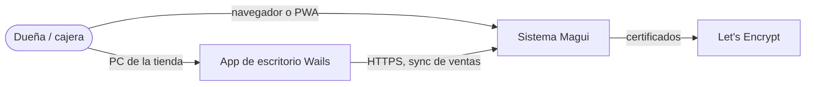
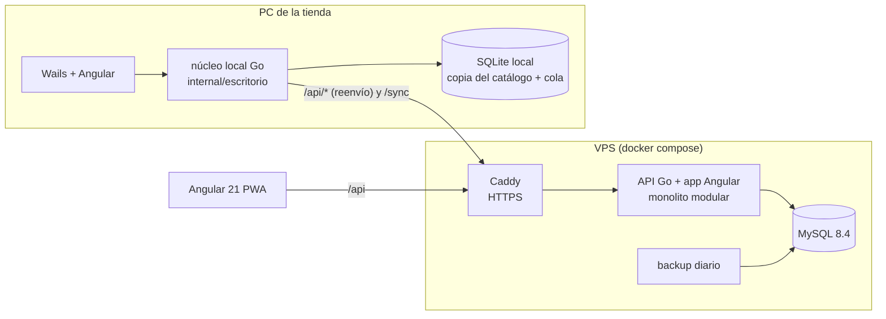

# Arquitectura — Sistema Magui (vista general)

Fuente original de la estrategia: `docs/PLAN.md` (requisitos, fases, offline) y `docs/CONVENCIONES.md` (capas y reglas).
Este documento resume la arquitectura vigente y enlaza los ADRs y diseños por funcionalidad.

## Contexto y requisitos de calidad
- Una tienda (perfumería/cosmética) con una dueña y 1–3 puestos de cobro. Acceso con una sola clave compartida (sin usuarios).
- **Disponibilidad en caja:** nunca dejar de cobrar → el escritorio cobra sin conexión y sube las ventas después.
  El resto (compras, catálogo, estadísticas) requiere conexión.
- **Consistencia:** stock = suma de movimientos; operaciones de varias tablas en una transacción; control de versión
  optimista en lo editable.
- **Costo:** un VPS chico (1 GB RAM) con Docker; sin servicios pagos.
- **Datos personales:** no se guardan datos de clientes (Ley 25.326: mínimo necesario).

## C4 nivel 1 — Contexto

## C4 nivel 2 — Contenedores

## Módulos (monolito modular, hexagonal)
| Módulo | Responsabilidad | Tablas propias |
|---|---|---|
| catalogo | productos, combos, categorías, empresas, precios e historial | producto, combo_item, categoria, producto_categoria, empresa, precio_historial |
| inventario | lotes, movimientos, FEFO, vencimientos, ajustes | lote, movimiento_stock, configuracion |
| compras | compras de mercadería, edición y su auditoría | compra, compra_item, compra_edicion |
| ventas | ventas, pagos, anulación | venta, venta_item, venta_pago |
| caja | gastos y retiros | gasto_caja |
| estadisticas | solo lectura | — |
| sync / escritorio | catálogo para el escritorio, subida de ventas offline | esquema local propio |
| auth | clave única, sesiones | credencial_acceso |

Comunicación entre módulos: puertos en `application` del módulo que consume + adaptador `adapters/enlaces`, en el mismo
proceso, compartiendo la transacción por `context` (ADR 0001 lo aplica a la edición de compras).

## Datos, integraciones, seguridad, observabilidad y despliegue
- Datos: MySQL 8.4 en producción; migraciones goose embebidas, en paralelo `mysql/` y `sqlite/`; escritorio con esquema
  `escritorio/`. Dinero `DECIMAL(12,2)` / centavos. IDs UUID v7. Fechas en UTC, se muestran en hora de Argentina.
- Integraciones externas: ninguna por ahora.
- Seguridad: token Bearer, CSP estricta, límites de tamaño de cuerpo, rate limit de login. Ver `docs/security/`.
- Observabilidad: `slog` con `request_id`; 5xx registrados sin exponer detalles.
- Despliegue: `docs/DESPLIEGUE.md` (Docker + Caddy + backups).

## Decisiones y diseños
- ADRs: [`adr/README.md`](adr/README.md).
- Editar una compra (US-001a/b/c): [`editar-compra.md`](editar-compra.md).
