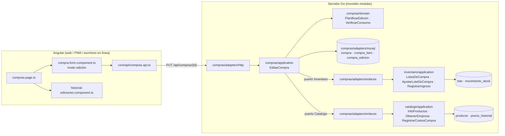
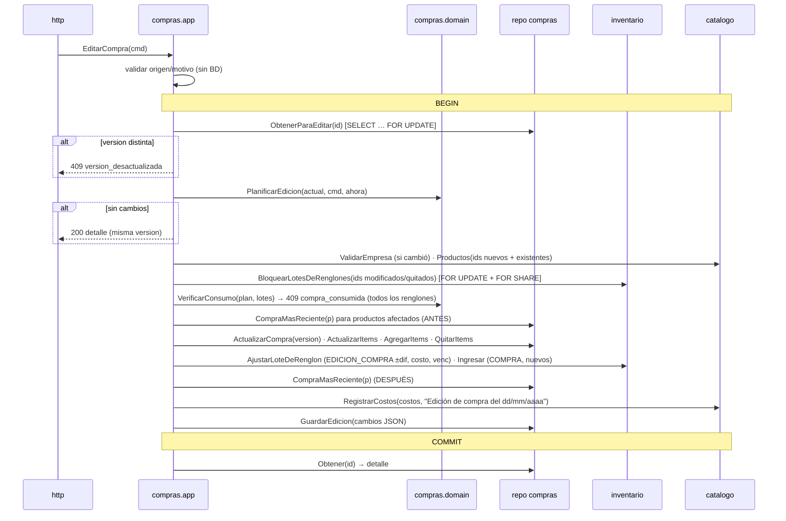

# Diseño técnico — Editar una compra (US-001a/b/c)

Autor: Software Architect · Fecha: 2026-10-27 · Estado: Propuesto (gate G2)
Historias: [US-001](../product/stories/US-001-editar-compra.md), [a](../product/stories/US-001a-editar-cabecera-compra.md),
[b](../product/stories/US-001b-editar-renglones-compra.md), [c](../product/stories/US-001c-agregar-quitar-renglones-compra.md)
ADRs: [0001](adr/0001-orquestar-edicion-de-compra-desde-compras.md) · [0002](adr/0002-concurrencia-edicion-compra-version-y-bloqueo-de-lotes.md) ·
[0003](adr/0003-tipo-de-movimiento-edicion-compra.md) · [0004](adr/0004-baja-logica-de-renglones-de-compra.md) ·
[0005](adr/0005-auditoria-de-ediciones-de-compra-en-json.md) · Datos: [docs/data/editar-compra.md](../data/editar-compra.md) ·
Contrato: [docs/API.md § Compras](../API.md#compras)

Las tres partes se diseñan ahora; se implementan en orden a → b → c. Cada parte deja el contrato y el modelo final
en su lugar y solo **habilita** más casos (lo no habilitado responde 422 con un código explícito).

## 1. Componentes involucrados


Todas las flechas del servidor comparten **una** transacción (`db.Transactor` en el `context`).

## 2. Flujo de `EditarCompra` (estado final, parte c)



### 2.1 Comando y plan (dominio puro)
```go
// compras/application
type ComandoEditarCompra struct {
    ID        string
    Version   int
    Fecha     FechaEditada      // {Dia *fecha.Fecha; Instante *time.Time} — exactamente uno
    EmpresaID string            // "" = sin empresa
    Notas     string
    Origen    domain.Origen     // "" = WEB
    Motivo    string            // opcional, <= 255
    Items     *[]ItemEdicionCmd // nil = renglones sin cambios
}
type ItemEdicionCmd struct {
    ID               string // "" = renglón nuevo (c)
    ProductoID       string
    Cantidad         int
    CostoUnitario    dinero.Dinero
    PrecioVentaNuevo *dinero.Dinero
    Vencimiento      *fecha.Fecha
}
```
Reglas de `PlanificarEdicion(actual domain.Compra, cambios, ahora) (domain.PlanEdicion, error)`:
- **Fecha** (la pantalla manda `AAAA-MM-DD`): si el día (Argentina) es igual al de la compra → se conserva el instante
  original (no es cambio). Si es otro día: hoy → `ahora`; otro → mediodía de Argentina (igual que `POST`). Con instante
  ISO se usa tal cual. Fecha futura (> ahora + 1 h) → 422 `fecha`.
- **Notas** recortadas, ≤ 500; vacío = NULL. **Empresa** "" = NULL. **Motivo** recortado, ≤ 255 → 422 `motivo`.
  **Origen** inválido → 422 `origen` ("Use WEB, MOVIL o DESKTOP").
- **Renglones** (b, c). Por cada `items[i]`:
  - con `id`: debe ser un renglón vigente de la compra → si no, 422 `items[i].id` "El renglón no pertenece a esta compra";
    `id` repetido → 422 `items[i].id`; `productoId` distinto al guardado → 422 `items[i].productoId`
    "No se puede cambiar el producto de un renglón: quitalo y agregá otro" (RN-EC-01).
  - sin `id`: renglón nuevo (c). En b → 422 `items` código `renglones_nuevos_no_disponibles`.
  - renglones vigentes omitidos = quitados (c). En b → 422 `items` código `quitar_renglones_no_disponible`.
  - validaciones de `NuevaCompra` (cantidad > 0, costo ≥ 0, precio > 0 si viene, 1..300 renglones) con las mismas
    claves `items[i].campo`. Se extrae a `domain.validarItems` para usar la misma función en alta y edición.
  - En a, `items != nil` → 422 código `renglones_no_editables` "Editar renglones todavía no está disponible".
- Resultado: cabecera nueva, `[]RenglonModificado{Item, Anterior, Diferencia, CambioCosto, CambioVenc, CambioPrecio}`,
  `[]Item agregados`, `[]Item quitados`, total nuevo (RN-EC-20), documento de cambios (ADR 0005) y `SinCambios`.
  `SinCambios` ignora `origen` y `motivo` (RN-A-02).

### 2.2 Consumo (b, c)
`VerificarConsumo(plan, lotes map[itemID]LoteRenglon) error` — para cada renglón con `Diferencia < 0` o quitado:
- `consumido = cantidadActual − stockLote`.
- modificado: si `stockLote + diferencia < 0` → mensaje en `fields["items[i].cantidad"]`:
  "Kaiak Clásico: de las 4 unidades de esta compra ya salieron 3 (ventas o ajustes). Solo podés bajar hasta 3 unidades."
- quitado: si `consumido > 0` → `fields["quitados[<itemId>]"]`:
  "Ekos Jabón: ya salió 1 de las 10 unidades; no se puede quitar. Podés bajar la cantidad hasta 1."
- Si hay al menos uno → `errores.Conflicto("compra_consumida", "Hay unidades de esta compra que ya salieron del stock")`
  con **todos** los `fields` (RN-B-02). Nada se escribió todavía.
- Lote no encontrado para un renglón → error interno (invariante, ver `docs/data`).

### 2.3 Movimientos y lotes (b, c)
- Modificado con `Diferencia ≠ 0` → `EDICION_COMPRA` por la diferencia en el mismo lote (RN-EC-05/06/08, RN-B-03).
- Modificado con costo o vencimiento distinto → `UPDATE lote SET costo_unitario, fecha_vencimiento` (RN-EC-11). Sin movimiento.
- Quitado → `EDICION_COMPRA` por `−cantidad` del renglón (RN-EC-09) y `compra_item.quitado_en = ahora`.
- Agregado → `RegistrarIngreso` tipo `COMPRA` (lote nuevo, RN-EC-10).
- Nota de todos: "Edición de compra del dd/mm/aaaa" (fecha **nueva** de la compra, Argentina).

### 2.4 Último costo y precio (b, c)
Productos afectados:
- b: productos con un renglón modificado cuyo `costoUnitario` o `precioVentaNuevo` cambió.
- c: + productos de renglones agregados o quitados + **si cambió la fecha**, todos los productos de la compra (antes y
  después) (RN-C-04).

Para cada producto afectado `p` (en orden de primer renglón):
```
antes   := repo.CompraMasReciente(p)   // antes de escribir
despues := repo.CompraMasReciente(p)   // después de escribir compra y renglones (misma tx)
si despues.CompraID == esta compra:
    costo  := despues.Costo                               // último renglón vigente de p (mayor compra_item.id), RN-EC-16
    precio := precioVentaNuevo del último renglón vigente de p cuyo precio cambió en esta edición
              (modificado con valor distinto y no vacío, o agregado con precio); si no hay → nil   // RN-EC-17/18, D-6
    emitir {p, costo, precio}
si no, si antes.CompraID == esta compra y despues existe:   // dejó de ser la más reciente (c, RN-EC-19)
    emitir {p, despues.Costo, nil}
si no: nada                                                  // no es la más reciente, o no queda ninguna compra
```
- No emitir si `costo == producto.Costo` y `precio == nil` (evita subir la versión del producto sin cambios).
- `catalogo.RegistrarCostos(emitidos, "Edición de compra del dd/mm/aaaa")`: ya ignora un precio igual al actual
  (no agrega historial) y nunca revierte el precio.
- En a no se toca catálogo (aunque cambie la fecha; RN-C-04 entra en c).

### 2.5 Auditoría
`repo.GuardarEdicion(domain.Edicion{ID, CompraID, Fecha: ahora, Origen, Motivo, Version: nueva, Cambios})` al final
de la tx. Si falla, se revierte todo (escenario "Todo o nada").

## 3. Contrato (resumen; el detalle normativo está en `docs/API.md`)
- `PUT /api/compras/{id}` → `200` detalle; `404 compra_no_encontrada`; `404 empresa_no_encontrada`;
  `404 producto_no_encontrado`; `409 version_desactualizada`; `409 compra_consumida` (con `fields`);
  `409 operacion_concurrente`; `422 datos_invalidos` (con `fields`), `422 producto_no_comprable`,
  `422 renglones_no_editables` (solo a), `422 renglones_nuevos_no_disponibles` / `quitar_renglones_no_disponible` (solo b).
- "Sin cambios": `200` con la **misma** `version` que se envió. El frontend muestra "No había cambios".
- `GET /api/compras/{id}` suma `version`, `editadaEn`, `ediciones[]` (a) e `items[].consumido` (b).
- `GET /api/compras` suma `version` y `editadaEn` (a) para la marca "Editada el …".
- `GET /api/inventario/movimientos?tipo=EDICION_COMPRA` (b).
- No hay `docs/api/openapi.yaml` en el repo: la fuente del contrato es `docs/API.md` (convención vigente).

## 4. Plan de implementación por parte

### Parte a — US-001a (cabecera + versión + auditoría)
**Backend**
| Archivo | Cambio |
|---|---|
| `backend/migrations/mysql/00004_editar_compra.sql`, `backend/migrations/sqlite/00004_editar_compra.sql` | Nuevas (ver `docs/data`) |
| `internal/compras/domain/compra.go` | `Compra.Version`, `Compra.UpdatedAt`; extraer `validarCabecera`/`validarItems` de `NuevaCompra`; `ErrVersionDesactualizada`, `ErrRenglonesNoEditables` |
| `internal/compras/domain/origen.go` (nuevo) | `Origen` + `ParseOrigen` (WEB/MOVIL/DESKTOP, vacío = WEB) |
| `internal/compras/domain/edicion.go` (nuevo) | `PlanEdicion`, `PlanificarEdicion` (cabecera completa; renglones: rechaza `items != nil`), `Edicion`, documento `Cambios` v1 con `Renglones []CambioRenglon` ya definido (vacío en a), `MarshalJSON` |
| `internal/compras/application/compras.go` | Puertos: `Repositorio` += `ObtenerParaEditar`, `ActualizarCompra(c, versionAnterior)`, `GuardarEdicion`, `Ediciones`; `ComandoEditarCompra`, `FechaEditada`, `ItemEdicionCmd` (definidos completos); `EditarCompra`; `ObtenerCompra` agrega `ediciones`. DTOs: `CompraResumen.Version`, `CompraResumen.EditadaEn`, `CompraDetalle.Ediciones`, `EdicionDTO` |
| `internal/compras/application/edicion.go` (nuevo, opcional) | El caso de uso separado de `compras.go` para que b y c sumen pasos sin crecer un solo archivo |
| `internal/compras/adapters/mysql/repositorio.go` | `Guardar` con `version`/`updated_at`; `consultaResumen` con `c.version`, `c.updated_at`; `ObtenerParaEditar` (`FOR UPDATE`, devuelve `domain.Compra` con renglones y nombres de empresa/productos para el documento); `ActualizarCompra` (`WHERE id=? AND version=?`); `GuardarEdicion`; `Ediciones` (`ORDER BY version DESC`) |
| `internal/compras/adapters/http/handler.go` | `r.Put("/{id}", h.editar)`; `edicionReq{fecha, empresaId, notas, version, origen, motivo, items *[]itemEdicionReq}` con `id` en `itemEdicionReq`; parseo de fecha día/instante; `version` requerida (≥ 1) → 422 `version` |
| `internal/compras/adapters/enlaces/enlaces.go` | `Catalogo.Productos` devuelve también `Costo` y `PrecioVenta` (se usa en b; se agrega ya para no tocar el puerto dos veces) |
| `docs/API.md` | Ya actualizado por arquitectura; el dev ajusta si algo cambia |

**Frontend**
| Archivo | Cambio |
|---|---|
| `core/api/compras.api.ts` | `version`, `editadaEn` en `CompraResumen`; `ediciones` en `CompraDetalle`; tipos `EdicionCompra`, `CambioCampo`, `CambioRenglon` (completos, aunque en a solo llegue cabecera); `EditarCompra` con `items?` y `editar(id, body)` |
| `features/compras/compras.page.ts` | Botón "Editar" junto a "Ver" (`aria-label` con la fecha); modal de edición; marca "Editada el dd/mm/aaaa hh:mm"; bloque "Historial de ediciones" en el detalle; toasts "Compra actualizada" / "No había cambios" (comparando `version`) ; ante 409 `version_desactualizada` → mensaje y recarga del detalle |
| `features/compras/compra-form.component.ts` | `input compra: CompraDetalle \| null` → modo edición: precarga cabecera, renglones solo lectura con aviso "cambiar renglones llega en una próxima versión", campo "Motivo (opcional)", botón "Guardar cambios", envía `version` y `origen` (`ES_ESCRITORIO ? 'DESKTOP' : 'WEB'`, igual que ventas) y **no** envía `items`. Fecha siempre `AAAA-MM-DD` |
| `features/compras/historial-ediciones.component.ts` (nuevo) | Dibuja `ediciones[]` (cabecera y renglones; "Sin ediciones" si vacío). Formatea según `campo` (fecha, dinero, día) |

**Tests a**
- `domain/edicion_test.go`: mismo día conserva instante; cambio a hoy usa `ahora`; otro día = mediodía AR; futura → 422;
  notas > 500; motivo > 255; origen inválido; quitar empresa; sin cambios (incluye solo motivo/origen); `items != nil` → 422;
  documento JSON exacto (golden) para el escenario "Quedan registrados los cambios".
- `application/compras_test.go` (fakes): extender `repoMem` con versión, `ObtenerParaEditar`, `ActualizarCompra`,
  `GuardarEdicion`, `Ediciones`. Casos: edición feliz (versión 2, una edición, catálogo/inventario sin llamadas);
  409 versión; 404 compra; 404 empresa; sin cambios no escribe; fallo en `GuardarEdicion` devuelve error.
- `adapters/mysql/mysql_test.go`: registrar → editar cabecera → detalle con `version 2`, `ediciones[0]` y listado con
  `editadaEn`; `ActualizarCompra` con versión vieja → 409; todo o nada: repositorio envoltorio cuyo `GuardarEdicion`
  falla → la compra queda como estaba (tx real); estadísticas: `compras` del período cambia al mover la fecha.
- `platform/db/migrate_sqlite_test.go`: `compra_edicion` creada; ida y vuelta.
- Front (`*.spec.ts` si el repo los usa para la pieza): `historial-ediciones` formatea cabecera.

**Queda preparado para b y c:** contrato `PUT` final (incluye `items` con `id`), comando y `ItemEdicionCmd` completos,
formato de auditoría v1 con `renglones`, versión y bloqueo de la compra, `Origen`, validación de renglones extraída,
puerto de catálogo con costo/precio, componente de historial que ya sabe dibujar renglones.

### Parte b — US-001b (renglones existentes)
**Backend**
| Archivo | Cambio |
|---|---|
| `backend/migrations/{mysql,sqlite}/00005_movimiento_edicion_compra.sql` | Nuevas |
| `internal/inventario/domain/inventario.go` | `MovEdicionCompra`; `Valido()` |
| `internal/inventario/application/puertos.go` | `Repositorio` += `BloquearLotes(ids)`, `LotesPorCompraItem(itemIDs, bloquear)`, `ActualizarLote(id, costo, venc)`; `LotesConStock(productoID, bloquear)` |
| `internal/inventario/application/servicio.go` | `LotesDeCompra(itemIDs, bloquear)`, `AjustarLoteDeCompra(AjusteLoteCompra)`; `RegistrarSalida` y `ajustarLote` usan lectura bloqueante (ADR 0002) |
| `internal/inventario/application/modelos.go` | `AjusteLoteCompra{LoteID, Diferencia, Costo, Vencimiento, CompraID, Nota}` |
| `internal/inventario/adapters/mysql/repositorio.go` | Consultas `FOR UPDATE` / `FOR SHARE`; `UPDATE lote` |
| `internal/platform/db/tx.go` (o `errores.go` nuevo) | Traducir MySQL 1213/1205 a 409 `operacion_concurrente` |
| `internal/compras/domain/edicion.go` | Renglones modificados, `VerificarConsumo`, `ErrCompraConsumida`; en b rechaza nuevos/omitidos |
| `internal/compras/application/compras.go` | Puertos `Inventario` += `LotesDeRenglones`, `BloquearLotesDeRenglones`, `AjustarLoteDeRenglon`; `Repositorio` += `ActualizarItems`, `CompraMasReciente`; pasos 2.2–2.4; `ObtenerCompra` completa `items[].consumido` |
| `internal/compras/adapters/enlaces/enlaces.go` | Implementar los puertos nuevos |
| `internal/compras/adapters/mysql/repositorio.go` | `ActualizarItems`, `CompraMasReciente` |

**Frontend**
| Archivo | Cambio |
|---|---|
| `core/api/inventario.api.ts` | `EDICION_COMPRA: 'Edición de compra'` |
| `core/api/compras.api.ts` | `items[].consumido` |
| `features/compras/compra-form.component.ts` | Renglones editables en modo edición (producto fijo), "ya salieron N de M", `min = max(N, 1)`, resumen de efectos antes de guardar (stock ±, precio de venta que cambiará — solo informativo: el servidor decide), mapeo de `fields` del 409 `compra_consumida` al renglón, envía `items` con `id` |
| `features/compras/historial-ediciones.component.ts` | Ya dibuja renglones (verificar textos) |

**Tests b**
- `inventario/domain`: `Valido(EDICION_COMPRA)`.
- `inventario/application/servicio_test.go`: `AjustarLoteDeCompra` (+2, −1, hasta 0, por debajo → `stock_insuficiente`,
  solo costo/venc sin movimiento, diferencia 0 sin movimiento).
- `compras/domain`: consumo (venta, ajuste, combo y anulación vistos como stock del lote), varios bloqueados en un error,
  cambio de producto → 422, id ajeno/duplicado → 422.
- `compras/application` (fakes con lotes y "más reciente"): todos los escenarios Gherkin de b, incluyendo "no es la más
  reciente", desempate por `created_at`, precio sin cambios no pisa manual, vaciar precio, precio igual al actual,
  producto inactivo, todo o nada (nada se llama a inventario/catálogo si hay consumo).
- `compras/adapters/mysql/mysql_test.go`: flujo real con venta + edición; `EDICION_COMPRA` filtrable;
  `precio_historial` con motivo "Edición de compra del …"; **concurrencia**: dos conexiones, una venta y una baja sobre
  el mismo lote en goroutines → el lote nunca queda < 0 y una de las dos recibe el error esperado.
- `ventas/adapters/mysql/mysql_test.go`: regresión de ventas con el bloqueo nuevo (venta simple, combo, offline sin stock).
- `migrate_sqlite_test.go`: CHECK acepta `EDICION_COMPRA`, vistas OK.

**Queda preparado para c:** `CompraMasReciente` con filtro de vigentes como parámetro único a cambiar, cálculo de
productos afectados extensible, ajuste de lote que sirve para quitar.

### Parte c — US-001c (agregar y quitar)
**Backend**
| Archivo | Cambio |
|---|---|
| `backend/migrations/{mysql,sqlite}/00006_renglon_compra_quitado.sql` | Nuevas |
| `internal/compras/domain/edicion.go` | Habilitar nuevos y omitidos; RN-C-01 (≥ 1), máx. 300; quitados en `VerificarConsumo`; documento AGREGADO/QUITADO |
| `internal/compras/application/compras.go` | Validar productos nuevos (existe, no combo); `Ingresar` para nuevos; quitar con `AjustarLoteDeRenglon(−cantidad)`; productos afectados por alta/baja/fecha; regla "dejó de ser la más reciente" |
| `internal/compras/adapters/mysql/repositorio.go` | `AgregarItems` (reusar el INSERT de `Guardar`), `QuitarItems(ids, ahora)`; filtro `quitado_en IS NULL` en `Obtener`, `consultaResumen`, `ObtenerParaEditar`, `CompraMasReciente` |

**Frontend**
| Archivo | Cambio |
|---|---|
| `features/compras/compra-form.component.ts` | En edición: "Agregar producto" (buscador, solo activos) y "Quitar" por renglón, deshabilitado con explicación si `consumido > 0`; renglones nuevos sin `id`; resumen "se quitarán 10 unidades de Ekos Jabón del stock"; mapear `fields["quitados[<id>]"]` |

**Tests c**
- `compras/domain`: agregar, quitar, quitar todo → 422, 301 → 422, quitar con consumo → 409 con clave `quitados[id]`.
- `compras/application`: escenarios Gherkin de c (recalcular último costo al quitar y al cambiar fecha en ambos sentidos,
  no queda otra compra → se mantiene, precio nunca se revierte, combo → 422, producto inexistente → 404, todo o nada).
- `compras/adapters/mysql/mysql_test.go`: quitar renglón → detalle/listado/`productos`/`unidades` sin él, lote con stock 0
  y sus movimientos intactos, otra compra pasa a ser la más reciente.

## 5. Observabilidad
- Errores 5xx ya se registran con `request_id` (`httpx.Error`). Agregar un `log.Info("compra editada", compra_id,
  version, origen, renglones_modificados, agregados, quitados)` en el handler tras un 200 con cambios (sin montos ni motivo).
- Los 409 `operacion_concurrente` se registran en `Warn` para medir el disparador de revisión del ADR 0002.

## 6. Riesgos
| Riesgo | Mitigación |
|---|---|
| Bloqueos nuevos en el camino de ventas | Solo por producto; test de regresión de ventas; métrica de 409 `operacion_concurrente` |
| Olvidar `quitado_en IS NULL` en una consulta nueva | Test de integración de c; ADR 0004 |
| Fecha "mismo día" mal comparada (UTC vs Argentina) | Test de dominio con compras de 22:30 AR (día siguiente en UTC) |
| Diferencia de criterio de "último costo" entre alta y edición | Resuelta P-A1: el alta se alinea en la parte b |

## 7. Preguntas resueltas (cliente, 2026-10-27)
- **P-A1** Se alinea el alta: `POST /compras` pasa a usar el mismo criterio "más reciente por fecha" (D-4) para último
  costo y precio. Se implementa junto con la parte b.
- **P-A2** Al quitar un renglón se descuenta solo la cantidad que trajo la compra; lo sumado por ajustes manuales queda
  en el lote. Reemplaza el "todo el stock del lote" de RN-EC-09.
- **P-A3** Se mantiene **409** `compra_consumida` y 404 `empresa_no_encontrada`, según las historias.
- (Resuelta) La edición desde el escritorio requiere conexión: el handler local reenvía el resto de `/api/*` con un
  `httputil.ReverseProxy` (todos los métodos, incluido `PUT`); sin conexión responde 503 `sin_conexion`. No hay cambios
  en `internal/escritorio`.
