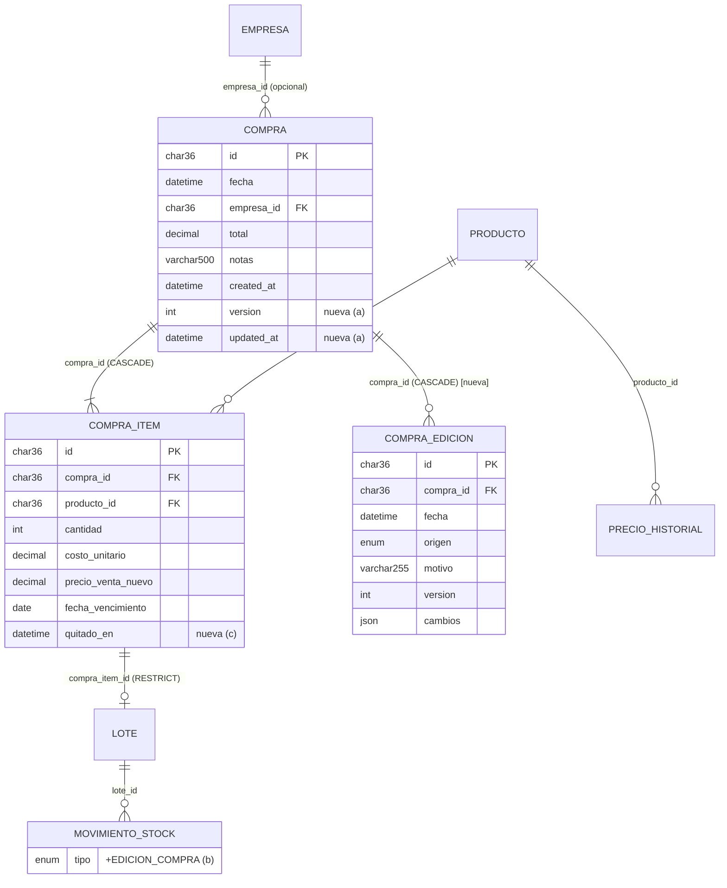

# Modelo de datos — Editar una compra (US-001a/b/c)

Autoría: Software Architect + Database Engineer · Fecha: 2026-10-27 · ADRs: 0002, 0003, 0004, 0005

Motor de producción: **MySQL 8.4** (InnoDB; las transacciones de la aplicación corren en `READ COMMITTED`, ver ADR 0002). `migrations/sqlite` se mantiene **en paralelo**
(mismas tablas y columnas, convención del repo) aunque el servidor no lo usa para compras/inventario; el escritorio
usa su propio esquema (`migrations/escritorio`) y **no cambia**. Migraciones con goose, embebidas en el binario.

Las migraciones son tres, **una por parte** (cada rebanada sale con la suya; el diseño de las tres ya está cerrado):

| N.º | Archivo (mysql/ y sqlite/) | Parte | Contenido |
|---|---|---|---|
| 00004 | `00004_editar_compra.sql` | a | `compra.version`, `compra.updated_at`, tabla `compra_edicion` |
| 00005 | `00005_movimiento_edicion_compra.sql` | b | valor `EDICION_COMPRA` en `movimiento_stock.tipo` |
| 00006 | `00006_renglon_compra_quitado.sql` | c | `compra_item.quitado_en` |

> Si a, b y c salen en el mismo release, igual se mantienen los tres archivos (rollback por parte).

## 1. Diagrama (solo lo que cambia)



## 2. Diccionario (columnas nuevas o modificadas)

| Tabla | Columna | MySQL | SQLite | Null | Default | Descripción / regla | Sensible |
|---|---|---|---|---|---|---|---|
| compra | version | `INT UNSIGNED` | `INTEGER` | No | 1 | Control optimista. Sube 1 por edición efectiva (RN-EC-23, RN-EC-04) | No |
| compra | updated_at | `DATETIME(3)` | `TEXT` (ISO UTC) | No | MySQL `CURRENT_TIMESTAMP(3)`; SQLite `''` | Última edición. Backfill = `created_at`. La API expone `editadaEn` = `updated_at` solo si `version > 1` | No |
| compra_edicion | id | `CHAR(36) ascii` PK | `TEXT` PK | No | — | UUID v7 | No |
| compra_edicion | compra_id | `CHAR(36) ascii` FK → compra(id) `ON DELETE CASCADE` | `TEXT` FK idem | No | — | | No |
| compra_edicion | fecha | `DATETIME(3)` | `TEXT` | No | — | Momento de la edición (UTC) | No |
| compra_edicion | origen | `ENUM('WEB','MOVIL','DESKTOP')` | `TEXT CHECK (…)` | No | — | Lo envía el cliente; por defecto WEB | No |
| compra_edicion | motivo | `VARCHAR(255)` | `TEXT` | Sí | NULL | Opcional (D-11). Vacío → NULL | Texto libre: no cargar datos personales |
| compra_edicion | version | `INT UNSIGNED` | `INTEGER` | No | — | Versión de la compra **después** de la edición. `UNIQUE (compra_id, version)` | No |
| compra_edicion | cambios | `JSON` | `TEXT CHECK (json_valid(cambios))` | No | — | Documento v1 (ADR 0005) | No |
| movimiento_stock | tipo | `ENUM(…,'EDICION_COMPRA')` | `TEXT CHECK (… 'EDICION_COMPRA')` | No | — | ADR 0003 | No |
| compra_item | quitado_en | `DATETIME(3)` | `TEXT` | Sí | NULL | NULL = renglón vigente (ADR 0004) | No |

**Índices:** `compra_edicion` → `UNIQUE (compra_id, version)` (sirve para el FK, para listar el historial
`ORDER BY version DESC` y para impedir dos filas de la misma edición). No se agregan índices a `compra_item` (ver ADR 0004).

**Consultas nuevas y su índice:**
| Consulta | Índice que usa |
|---|---|
| Lote de cada renglón: `lote WHERE compra_item_id IN (…)` | **Falta índice**: `lote.compra_item_id` tiene FK, y en MySQL la FK crea índice implícito (`fk_lote_compra_item`). En SQLite no hay índice → agregar `idx_lote_compra_item` en 00004 (sqlite) para paridad de rendimiento |
| Más reciente de un producto: `compra_item ci JOIN compra c … WHERE ci.producto_id = ? AND ci.quitado_en IS NULL ORDER BY c.fecha DESC, c.created_at DESC, c.id DESC, ci.id DESC LIMIT 1` | `idx_ci_producto` + PK de compra (decenas de filas por producto) |
| Historial: `compra_edicion WHERE compra_id = ? ORDER BY version DESC` | `uq_ce_compra_version` |
| Stock de lotes con bloqueo (lectura común tras `FOR UPDATE` de los lotes) | PK de lote + `idx_ms_lote` |

## 3. Migraciones planificadas (SQL de referencia)

### 00004 — parte a

**mysql/00004_editar_compra.sql**
```sql
-- Editar compras (US-001a): control de versión y auditoría de ediciones.

-- +goose Up
ALTER TABLE compra
  ADD COLUMN version    INT UNSIGNED NOT NULL DEFAULT 1,
  ADD COLUMN updated_at DATETIME(3)  NOT NULL DEFAULT CURRENT_TIMESTAMP(3);

-- Las compras existentes nunca se editaron: updated_at = created_at (la aplicación siempre informa updated_at al editar).
UPDATE compra SET updated_at = created_at;

CREATE TABLE compra_edicion (
  id        CHAR(36) CHARACTER SET ascii NOT NULL PRIMARY KEY,
  compra_id CHAR(36) CHARACTER SET ascii NOT NULL,
  fecha     DATETIME(3) NOT NULL,
  origen    ENUM('WEB','MOVIL','DESKTOP') NOT NULL,
  motivo    VARCHAR(255) NULL,
  version   INT UNSIGNED NOT NULL COMMENT 'Versión de la compra que dejó esta edición',
  cambios   JSON NOT NULL COMMENT 'Documento v1: cabecera y renglones con antes/después',
  CONSTRAINT fk_ce_compra FOREIGN KEY (compra_id) REFERENCES compra(id) ON DELETE CASCADE,
  CONSTRAINT uq_ce_compra_version UNIQUE (compra_id, version)
);

-- +goose Down
DROP TABLE IF EXISTS compra_edicion;
ALTER TABLE compra
  DROP COLUMN updated_at,
  DROP COLUMN version;
```

**sqlite/00004_editar_compra.sql**
```sql
-- Editar compras (US-001a): control de versión y auditoría de ediciones.

-- +goose Up
ALTER TABLE compra ADD COLUMN version INTEGER NOT NULL DEFAULT 1;
-- SQLite no admite un DEFAULT no constante en ADD COLUMN: la aplicación siempre informa updated_at.
ALTER TABLE compra ADD COLUMN updated_at TEXT NOT NULL DEFAULT '';
UPDATE compra SET updated_at = created_at;

CREATE TABLE compra_edicion (
  id        TEXT NOT NULL PRIMARY KEY,
  compra_id TEXT NOT NULL REFERENCES compra(id) ON DELETE CASCADE,
  fecha     TEXT NOT NULL,
  origen    TEXT NOT NULL CHECK (origen IN ('WEB','MOVIL','DESKTOP')),
  motivo    TEXT NULL,
  version   INTEGER NOT NULL,
  cambios   TEXT NOT NULL CHECK (json_valid(cambios)),
  UNIQUE (compra_id, version)
);
CREATE INDEX idx_lote_compra_item ON lote (compra_item_id);

-- +goose Down
DROP INDEX IF EXISTS idx_lote_compra_item;
DROP TABLE IF EXISTS compra_edicion;
ALTER TABLE compra DROP COLUMN updated_at;
ALTER TABLE compra DROP COLUMN version;
```

Código que acompaña: `compras/adapters/mysql.Guardar` pasa a insertar `version = 1` y `updated_at = created_at`
explícitos (así SQLite y MySQL quedan iguales).

### 00005 — parte b

**mysql/00005_movimiento_edicion_compra.sql**
```sql
-- Movimiento de stock por edición de una compra (US-001b, ADR 0003).

-- +goose Up
-- Agregar un valor al final del ENUM es solo metadatos; INSTANT hace fallar la migración si no lo fuera.
ALTER TABLE movimiento_stock
  MODIFY COLUMN tipo ENUM('INICIAL','COMPRA','VENTA','ANULACION','AJUSTE','EDICION_COMPRA') NOT NULL,
  ALGORITHM=INSTANT;

-- +goose Down
-- No se puede quitar el valor si hay filas: se pasan a AJUSTE marcando la nota (el stock no cambia).
UPDATE movimiento_stock
   SET tipo = 'AJUSTE', nota = LEFT(CONCAT('[EDICION_COMPRA] ', COALESCE(nota, '')), 255)
 WHERE tipo = 'EDICION_COMPRA';
ALTER TABLE movimiento_stock
  MODIFY COLUMN tipo ENUM('INICIAL','COMPRA','VENTA','ANULACION','AJUSTE') NOT NULL;
```

**sqlite/00005_movimiento_edicion_compra.sql** (reconstrucción: SQLite no permite cambiar un CHECK)
```sql
-- Movimiento de stock por edición de una compra (US-001b, ADR 0003).
-- Nada referencia a movimiento_stock por FK; las dos vistas sí la leen: se borran y se recrean.

-- +goose Up
DROP VIEW IF EXISTS v_stock_producto;
DROP VIEW IF EXISTS v_stock_lote;

CREATE TABLE movimiento_stock_nueva (
  id            TEXT NOT NULL PRIMARY KEY,
  producto_id   TEXT NOT NULL REFERENCES producto(id),
  lote_id       TEXT NULL REFERENCES lote(id),
  cantidad      INTEGER NOT NULL CHECK (cantidad <> 0),
  tipo          TEXT NOT NULL CHECK (tipo IN ('INICIAL','COMPRA','VENTA','ANULACION','AJUSTE','EDICION_COMPRA')),
  referencia_id TEXT NULL,
  nota          TEXT NULL,
  fecha         TEXT NOT NULL,
  created_at    TEXT NOT NULL DEFAULT (strftime('%Y-%m-%dT%H:%M:%fZ','now'))
);
INSERT INTO movimiento_stock_nueva (id, producto_id, lote_id, cantidad, tipo, referencia_id, nota, fecha, created_at)
SELECT id, producto_id, lote_id, cantidad, tipo, referencia_id, nota, fecha, created_at FROM movimiento_stock;
DROP TABLE movimiento_stock;
ALTER TABLE movimiento_stock_nueva RENAME TO movimiento_stock;

CREATE INDEX idx_ms_producto ON movimiento_stock (producto_id);
CREATE INDEX idx_ms_lote ON movimiento_stock (lote_id);
CREATE INDEX idx_ms_referencia ON movimiento_stock (referencia_id);
CREATE INDEX idx_ms_fecha ON movimiento_stock (fecha);
CREATE INDEX idx_ms_created ON movimiento_stock (created_at);

CREATE VIEW v_stock_lote AS
SELECT l.id AS lote_id, l.producto_id, l.fecha_vencimiento, l.costo_unitario,
       SUM(m.cantidad) AS stock
FROM lote l
JOIN movimiento_stock m ON m.lote_id = l.id
GROUP BY l.id;

CREATE VIEW v_stock_producto AS
SELECT p.id AS producto_id, COALESCE(SUM(m.cantidad), 0) AS stock
FROM producto p
LEFT JOIN movimiento_stock m ON m.producto_id = p.id
WHERE p.tipo = 'SIMPLE'
GROUP BY p.id;

-- +goose Down
UPDATE movimiento_stock
   SET tipo = 'AJUSTE', nota = substr('[EDICION_COMPRA] ' || COALESCE(nota, ''), 1, 255)
 WHERE tipo = 'EDICION_COMPRA';
-- (misma reconstrucción que en Up, con el CHECK original sin 'EDICION_COMPRA')
```
> El Down de SQLite repite la reconstrucción completa con el CHECK original; se omite acá por largo, el desarrollador
> lo escribe copiando el Up. Las definiciones de vistas e índices deben ser idénticas a `sqlite/00001`.

### 00006 — parte c

**mysql/00006_renglon_compra_quitado.sql**
```sql
-- Renglones de compra quitados al editar (US-001c, ADR 0004). Baja lógica: el lote sigue apuntando al renglón.

-- +goose Up
ALTER TABLE compra_item ADD COLUMN quitado_en DATETIME(3) NULL;

-- +goose Down
-- ATENCIÓN: si hay renglones quitados, al bajar la columna "reviven" (ver Rollback).
ALTER TABLE compra_item DROP COLUMN quitado_en;
```

**sqlite/00006_renglon_compra_quitado.sql**
```sql
-- +goose Up
ALTER TABLE compra_item ADD COLUMN quitado_en TEXT NULL;

-- +goose Down
ALTER TABLE compra_item DROP COLUMN quitado_en;
```

## 4. Compatibilidad con datos existentes
- Compras existentes: `version = 1`, `updated_at = created_at`, sin ediciones, todos sus renglones vigentes.
- Movimientos existentes: no se tocan. Lotes existentes: no se tocan (todos tienen `compra_item_id` si vinieron de una
  compra).
- Invariante que asume el código: **cada renglón de compra tiene exactamente un lote** (`RegistrarCompra` lo
  garantiza). Si al editar no se encuentra el lote de un renglón, el caso de uso devuelve 500 y se registra en el log
  (dato corrupto, no regla de negocio). Verificación previa al deploy de b:
  ```sql
  SELECT ci.id FROM compra_item ci LEFT JOIN lote l ON l.compra_item_id = ci.id WHERE l.id IS NULL;  -- debe dar 0 filas
  ```
- Todas las operaciones de 00004/00006 en MySQL 8.4 son `INSTANT` (agregar columnas) salvo el `UPDATE` de backfill
  (una fila por compra: cientos/miles, segundos). 00005 es `INSTANT`. Sin ventana de mantenimiento.
- El código de la parte a funciona con el esquema 00004 aunque 00005/00006 no estén aplicadas.
- Orden de deploy por parte: backup (`deploy/backup.sh`) → migración (la API la aplica al arrancar / `cmd/migrate`)
  → código nuevo. El código viejo funciona con el esquema nuevo (columnas con default, valor de enum extra no usado,
  `quitado_en` NULL), así que un rollback de código no requiere rollback de esquema.

## 5. Rollback
| Migración | Down seguro | Pérdida |
|---|---|---|
| 00004 | Sí | Se pierde el historial de ediciones y la versión (las compras quedan editadas con sus valores nuevos) |
| 00005 | Sí | Los `EDICION_COMPRA` pasan a `AJUSTE` con nota `[EDICION_COMPRA] …`; el stock no cambia |
| 00006 | **Solo si no hay renglones quitados.** Antes de bajar: `SELECT COUNT(*) FROM compra_item WHERE quitado_en IS NOT NULL` = 0 | Si hay quitados, volverían a aparecer en el detalle y el listado (el `total` guardado no los incluye, y su lote ya tiene stock 0): restaurar desde backup en lugar de bajar |

Preferencia operativa: ante un problema, **rollback de código** (el esquema nuevo es compatible hacia atrás) y dejar las
migraciones aplicadas.

## 6. Tests de esquema
- `platform/db/migrate_sqlite_test.go`: sumar `compra_edicion` a la lista de tablas; insertar un movimiento
  `EDICION_COMPRA` (acepta) y uno `OTRO` (rechaza); `json_valid` rechaza `cambios = 'x'`; `UNIQUE (compra_id, version)`;
  las vistas siguen calculando el stock después de 00005; ida y vuelta (`Reset` + `Up`).
- `compras/adapters/mysql/mysql_test.go` corre `m.Up` completo: cubre la sintaxis MySQL (incluido `ALGORITHM=INSTANT`).
